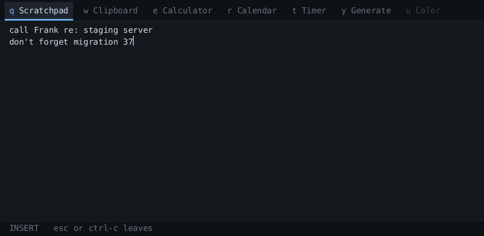
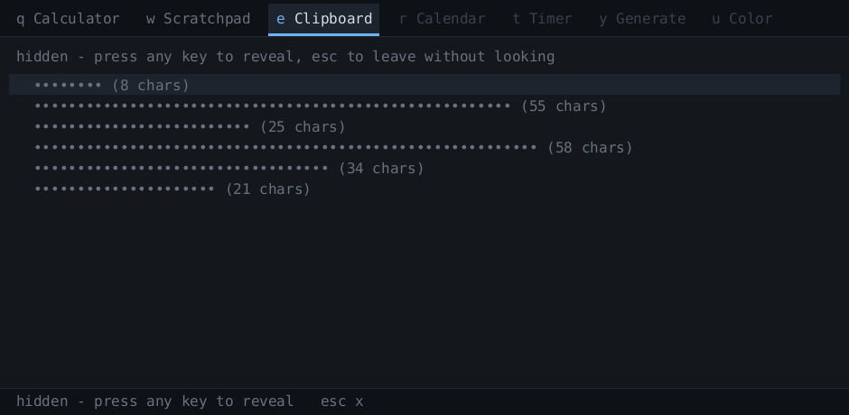

# Dropkick

Dropkick is a small collection of desktop tools that appears when you need it
and disappears when you don't.

It runs locally. It stores locally. It has no account system, no synchronisation
service, no telemetry, no advertisements, no AI integration, and no network
functionality.

Press a key. Do the thing. Get back to work.

## Status

Pre-alpha. All seven tools built: Scratchpad, Clipboard, Calculator, Calendar,
Timer, Generate and Color. Three keys stay deliberately unspent, and they
show as dimmed tabs already holding their permanent keys, so nothing renumbers
when they arrive.




Clipboard history, as it looks the moment you arrive — masked until you ask:



## How it behaves

There is no launcher screen and no root menu. Dropkick opens into whatever tool
you used last, with your values still in it, and the tools sit as tabs across the
top. So the common case costs nothing:

```
Super+D 437*1.18        you were already in the calculator (alt+e)
```

Switching tools is `Alt+Q`, `Alt+W`, `Alt+E`… — the top key row maps
left-to-right onto the tabs. `Alt+H` and `Alt+L` step to the previous and next
tab. `Alt`, not `Shift`, because `Shift+Q` is the letter `Q` and would be
swallowed by the tab bar the moment you started a note with it.

Dropkick takes the keyboard when it appears, so you can type immediately, and
then hands it straight back the moment you click something else. It is a
layer-shell surface rather than an ordinary window — that is what lets it map
instantly, above everything, with no click and no taskbar entry — but it should
not feel like one. If it is on screen without the keyboard, press the summon key
to dismiss it.

`Esc` always means "up one level": leave insert mode, leave the tool, dismiss.
Double-`Esc` dismisses from anywhere. `Ctrl+C` is a full alias for `Esc` — some
terminals swallow `Esc`, and the habit sticks.

## The rules

* **Offline only.** Not "works offline". There is no network. Dropkick does not
  know how to talk to one. Dropkick cannot upload your data because Dropkick has
  no networking code.
* **Local, inspectable data.** Plain files in a directory you can open, back up
  and delete yourself.
* **Keyboard-complete.** Nothing *requires* the mouse. The mouse is not
  forbidden; it is simply never necessary.
* **No plugins.** Plugins are how a small offline utility acquires third-party
  code that can read your clipboard and open sockets. If a utility is worth
  having, it gets reviewed and compiled in.
* **Minimal retention of sensitive data.** Clipboard history is designed as
  though it contains passwords, because eventually it will.

The no-networking rule is meant to be *checkable by a stranger*, not merely
promised:

* `dropkick-core` is `#![forbid(unsafe_code)]` and has zero dependencies.
* `deny.toml` fails the build if any crate capable of opening a socket enters
  the dependency tree. A pre-commit hook runs it, so the check happens whether
  or not anyone remembers to:

  ```
  cargo install cargo-deny
  git config core.hooksPath .githooks   # once per clone
  ```

  Git will not enable a hook from a cloned repository on its own, which is the
  right default — a repository that could run code on checkout would be a
  problem. So that second line is deliberate, and the hook is in `.githooks/`
  where you can read it before you turn it on.
* Planned: a seccomp filter that denies `socket()` for `AF_INET`/`AF_INET6` at
  startup, so the process cannot open a network connection even if something
  slipped through. `AF_UNIX` stays permitted — the Wayland connection needs it.

Dropkick talks to D-Bus for desktop notifications, the colour eyedropper, and
the keyring. That is also `AF_UNIX`, and the client is about 500 lines in this
repository rather than a dependency. If you would rather not have those
capabilities at all, build without them:

```
cargo build --release --no-default-features
```

The result contains no D-Bus code — something you can check with `strings`
rather than take on trust.

## Threat model

Dropkick protects against: casual filesystem inspection, other local users,
accidentally syncing sensitive data elsewhere, Dropkick itself transmitting
anything, and unnecessary long-term retention.

Dropkick does **not** protect against: a machine already compromised under your
account, keyloggers, clipboard-monitoring malware, or an attacker running with
your privileges. Offline-only is not the same as secure, and Dropkick cannot
make a compromised computer safe.

That last point is not hypothetical, and it is worth stating plainly because
most people do not know it: **on this system any program you run can silently
read your clipboard, continuously, with no prompt and no permission.** During
development a ~200-line script with no window and no keyboard focus attached to
the clipboard and read it in about a second, using `ext_data_control_manager_v1`.
That is how every clipboard manager works. It is the environment Dropkick lives
in, not something Dropkick introduces.

## Settings

`~/.config/dropkick/config`, written with every option and a comment on first
run. Plain `key = value`; `#` starts a comment. A key Dropkick does not
recognise is reported rather than ignored, so a typo cannot quietly look like it
worked.

Edits apply on the **next summon** — the file is checked every time the panel
opens, and re-read only when it has actually changed. There is nothing to
restart and no reload command to remember.

```
timer.notify = true      # notify when a countdown finishes
timer.sound = true       # ask the server to play a sound with it
timer.show_panel = false # also bring the panel up (off: it covers the screen)

generate.length = 20     # default password length
generate.lower = true    # a-z
generate.upper = true    # A-Z
generate.digits = true   # 0-9
generate.symbols = true  # !@#$%^&*-_=+?
generate.exclude_ambiguous = false   # leave out l I 1 O 0
```

Calendar shows a month at a time. `hjkl` or the arrows move a day at a time,
`[` and `]` step months, `t` jumps back to today, and a dot marks any day
holding something. `a` adds an entry: type what it is, press enter, then type
when — `15:00`, `3pm`, or leave it blank for an all-day item. `Tab` moves into
the day's list so `d` can delete one.

**It will not guess at a time.** If you type something that could be either,
like a bare `3`, it asks whether you meant 03:00 or 15:00 rather than picking
one and being quietly wrong.

The Calculator does arithmetic, unit conversion and date maths on the same line.

```
437*1.18              = 515.66
sqrt(2)*3             = 4.2426406871
25 feet in furlongs   = 0.0378787879 furlongs
98.6 F in C           = 37 C
today + 90 days       = 2026-11-20 (Friday)
2026-12-25 - today    = 125 days
```

`in` and `to` both work. Length, mass, volume, time, data, angle and
temperature are covered, and a conversion can take an expression: `(20+5) ft in
m`. `ans` reuses the last numeric answer.

Two places where a plausible-looking answer would be wrong, so the ambiguous
name refuses to be guessed at:

* **`gal` and `pt` are US measures**, which differ from the UK ones by about
  20%. The imperial versions are `impgal` and `imppt`.
* **`kb` is 1000 bytes.** For 1024 use `kib`, and likewise `mib` and `gib`.

There is no `month` or `year` unit, because neither is a fixed length. Months
and years exist in date maths, where a calendar makes the answer well-defined —
`2026-01-31 + 1 month` is the 28th of February, not the 3rd of March.

Color converts between the ways a colour gets written: type `#6FB3F2`,
`rgb(111, 179, 242)`, `hsl(210, 82%, 69%)` or a name like `tomato`, and it shows
all of them at once with a swatch. `Ctrl+Y` copies the hex — a chord rather than a
letter, because every letter you press is part of what you are typing.

**The eyedropper is built but switched off.** It would pick a colour off the
screen through the desktop's colour portal, and it is implemented, tested and
correct: the request goes out, the reply comes back, and the reply is a refusal.
COSMIC accepts the call and then declines it in about a millisecond, showing no
picker, for every application that asks — not just this one. Rather than offer a
key that cannot work, `Tab` says so. One line in `color.rs` turns it back on if
COSMIC ever implements the method.

## Where your data lives

These are your files. Go look at them, back them up yourself, delete them
yourself.

```
~/.local/share/dropkick/     things kept between sessions   (dir 0700, files 0600)
  calendar.txt               your entries, one per line, editable by hand
$XDG_RUNTIME_DIR/dropkick/   things wiped when you log out  (tmpfs, private)
```

The calendar file is plain text and sorts correctly with `sort`:

```
2026-08-21 15:00 Dentist
2026-08-21 --:-- Bin day
```

Edit it in any editor. A line Dropkick cannot understand is **kept, not
discarded** — it is written back untouched and reported, so a typo costs you
nothing.

Writes go to a temporary file that is renamed into place, so losing power
mid-save cannot leave you with half a calendar.

Nothing goes in `/tmp`: it is shared with every local user, so filenames are
visible there even when contents are not.

Most of it is plain and readable on purpose. Pinned clipboard entries and
anything you mark secret are encrypted through the OS keyring — and that
encryption makes one specific promise: it protects the file **if it leaves this
machine**, in a backup, a synced folder, or a disk that is stolen or resold. It
does not protect a machine already compromised under your account. If Dropkick
can decrypt without asking you, so can anything else running as you.

Dropkick will not ask you for a passphrase to open a scratchpad. That would be
real security bought by becoming the kind of software this is a reaction to.

Each tool decides whether it persists, and you can overrule it, including
turning persistence off entirely.

## The control socket

The daemon's control socket is the one piece of attack surface Dropkick adds. It
lives in `$XDG_RUNTIME_DIR` at mode 0600 and understands four verbs that move a
window. There is no verb that reads clipboard history back out, and there must
never be one.

## Measured findings (Pop!_OS 24.04, COSMIC, cosmic-comp)

Everything below was measured on the target machine, not assumed.

**Global shortcuts.** `org.freedesktop.portal.GlobalShortcuts` does not exist on
this system — the session portal exports 20 interfaces and that is not one of
them. So the summon path is a compositor keybinding running `dropkickctl`, which
poke the resident daemon over a Unix socket. Full cost of that hop, including
`fork`, `exec`, dynamic linking, connect, ack and exit: **~1.1 ms median,
1.4 ms p95**. Bind the key straight to the binary; going through `sh -c` would
cost more than everything the program does.

**Summon latency**, 20 consecutive summons, milliseconds from daemon poke:

| metric | min | median | p95 | max |
|---|---|---|---|---|
| poke → configure | 0.29 | 0.50 | 0.74 | 1.32 |
| poke → buffer committed | 0.34 | 0.58 | 1.19 | 1.40 |
| poke → frame presented | 1.67 | 11.42 | 36.62 | 36.88 |
| **poke → keyboard focus** | **0.28** | **0.48** | **0.72** | **1.30** |

Keyboard focus is the number that matters. On Wayland a client cannot buffer
input it does not have focus for: before `wl_keyboard.enter`, keystrokes go to
whatever the user was typing into. "Accepts keystrokes before it finishes
painting" is therefore not a buffering problem — it reduces to acquiring focus
faster than the human's next keypress.

And it resolves well: **focus consistently arrives before the first frame is
even committed**, roughly 0.5 ms after the poke and ~11 ms before anything is on
screen. Total keypress-to-input-live is about **1.6 ms**, against a 50 ms
budget. Presentation lags focus, and that is fine — it is the desired behaviour,
reached without any special effort.

**Show/hide must destroy and recreate the layer surface.** The wlr-layer-shell
spec says an unmapped surface can be re-mapped by committing without a buffer
and waiting for a configure. On cosmic-comp that does not work: the first summon
succeeds, and every subsequent one commits and never receives a configure again.
Measured 4/4 stalls after the first. Destroying the `zwlr_layer_surface_v1` on
hide and building a fresh one on show works 20/20 at the latencies above, so
that is the strategy. Both paths remain in the code behind `--strategy` so the
comparison can be re-run on other compositors.

## Building

Requires Rust (via rustup) and, on Pop!_OS/Ubuntu:

```
sudo apt install build-essential cmake just libexpat1-dev libfontconfig1-dev \
    libfreetype6-dev libxkbcommon-dev pkgconf
```

Then:

```
cargo build --release
```

## Binding a key

Dropkick cannot register a global hotkey itself. This is not laziness: the
Wayland compositor owns global shortcuts, and on this system
`org.freedesktop.portal.GlobalShortcuts` does not exist at all. So the binding
lives in COSMIC and runs `dropkickctl`, which pokes the daemon over a Unix
socket in about a millisecond.

Create `~/.config/cosmic/com.system76.CosmicSettings.Shortcuts/v1/custom`:

```
{
    (modifiers: [Super], key: "d"): Spawn("/path/to/dropkickctl toggle"),
}
```

Bind to the binary directly. Going through `sh -c` would cost more than
everything `dropkickctl` does.

**Do not take `Super+Space`.** COSMIC's defaults bind it to
`System(InputSourceSwitch)`. A custom binding does override it — verified — but
a chord the desktop already defines is a bad neighbour, and it will confuse you
on a machine where you really do run two keyboard layouts. As of COSMIC on
Pop!\_OS 24.04 the free single-letter Super chords are `c d e n p v z`; the
window manager owns the rest, and `Super` alone is the launcher.

You do not need an autostart entry. If no daemon is running, `dropkickctl`
starts one and retries, so the first press of the session costs ~25ms and every
press after that is ~1ms.

## Keys

Tools, by permanent key. The top row is the whole roster — **ten slots, ever** —
and a key never moves once assigned:

| key | tool | |
|---|---|---|
| `Alt+Q` | Scratchpad | built — notes, text transforms |
| `Alt+W` | Clipboard | built — history, search, pinning |
| `Alt+E` | Calculator | built — arithmetic, functions, unit conversion, date maths |
| `Alt+R` | Calendar | built — month grid, timed and all-day entries |
| `Alt+T` | Timer/Stopwatch | built — countdown, stopwatch, notification |
| `Alt+Y` | Generate | built — passwords and UUIDs; hashes planned |
| `Alt+U` | Color | built — hex/rgb/hsl/names; eyedropper blocked by COSMIC |
| `Alt+I` `Alt+O` `Alt+P` | — | deliberately unspent |

Calculator takes a plain expression: `+ - * / % ^`, parentheses, `sqrt abs ln
log sin cos tan round floor ceil`, the constants `pi` and `e`, and `ans` for the
previous result. `Enter` evaluates.

Clipboard opens **masked**: entries show as dots with a length until you press a
key. `Esc` leaves without revealing anything. Then `j`/`k` move, `/` searches,
`Enter` pastes the selection and dismisses, `p` pins, `d` deletes, `x` clears
everything unpinned, `c` pauses capture, `m` hides it again.

Timer takes a duration and starts: `25m`, `90`, `1h30m`, `2m30s` — a bare number
is seconds. `Enter` arms it, `space` starts and pauses, `w` runs a stopwatch
instead, `r` resets. It keeps counting while Dropkick is hidden and posts a
desktop notification when it finishes — a critical one, which waits until you
dismiss it rather than vanishing in three seconds, with a sound. Both of those
are settings.

It can also bring the panel up, which is off by default: it does not take the
keyboard, but it does cover the top of the screen, and a notification that waits
for you is usually enough. Turn on `timer.show_panel` if you want an alarm that
is unmissable rather than merely patient.

Scratchpad is vi-flavoured without being a vi clone. `i` `a` `A` `o` enter insert
mode and `Esc` leaves it; `hjkl` `0` `$` `gg` `G` move; `x` cuts a character and
`u` undoes.

Selection and the operators follow vi, so if you know vi you already know them:
`v` selects by character and `V` by line, `d` and `y` cut and copy either a
selection or a motion — `dd`, `yy`, `dG`, `ggdG` to wipe the lot. `Esc` unwinds
one level at a time: selection, then mode, then the panel.

**`Y` is the one place this departs from vi.** It copies the *whole buffer*,
where vi would copy one line. That is how you get text out of Dropkick without it
ever growing a file picker, and it is common enough here to be worth a single
key. If your fingers expect vi's `Y`, use `yy`.

Undo is per *burst*, not per character, so one `u` takes back a whole typing run
— which is also what makes a keystroke that landed before you saw the panel
recoverable.

Generate makes passwords and UUIDs. `p` and `u` pick which; for a password, `a`
`A` `0` `!` toggle the character types, `x` leaves out the lookalikes (`l I 1 O
0`), `+` and `-` change the length, `r` makes a new one and `y` copies it.

**Nothing it generates is stored.** There is no history, and the value is gone
when the panel closes. Copying a password does *not* put it in Dropkick's
clipboard history, and it goes onto the system clipboard tagged as a password so
that other clipboard managers skip it too. Randomness comes from the kernel
(`/dev/urandom`); if that cannot be read, Dropkick generates nothing rather than
falling back to something weaker.

## Trying the probe

```
./target/release/dropkickd --bench 20 --strategy recreate
```

Flashes a panel 20 times, grabs keyboard focus each time, prints the table
above. To exercise the real path instead, run the daemon and poke it:

```
./target/release/dropkickd
./target/release/dropkickctl toggle --time
```

The UI can also be rendered without a compositor, which is how it gets reviewed
without anyone having to describe a screenshot in prose:

```
./target/release/dropkickd --shot /tmp/dk
```

## Layout

```
crates/dropkick-core     utilities and state; knows nothing about any OS
crates/dropkick-linux    Wayland/COSMIC adapter, daemon, dropkickctl
```

A `dropkick-windows` crate joins them later. The core never learns what platform
it is on.

## Licence

Dropkick is MIT licensed — see `LICENSE`. Do what you like with it; keep the
copyright notice.

The 59 crates compiled in carry their own licences, listed in
`THIRD-PARTY-NOTICES.md` with the texts that apply. The short version: all
permissive, nothing copyleft, so nothing here obliges you to publish your own
source if you build on it. Most offer a choice of MIT or Apache-2.0 and Dropkick
elects MIT; two licences cannot be elected away, `Zlib` via `foldhash` and
`Unicode-3.0` via `unicode-ident`, and both are satisfied by shipping that file.
