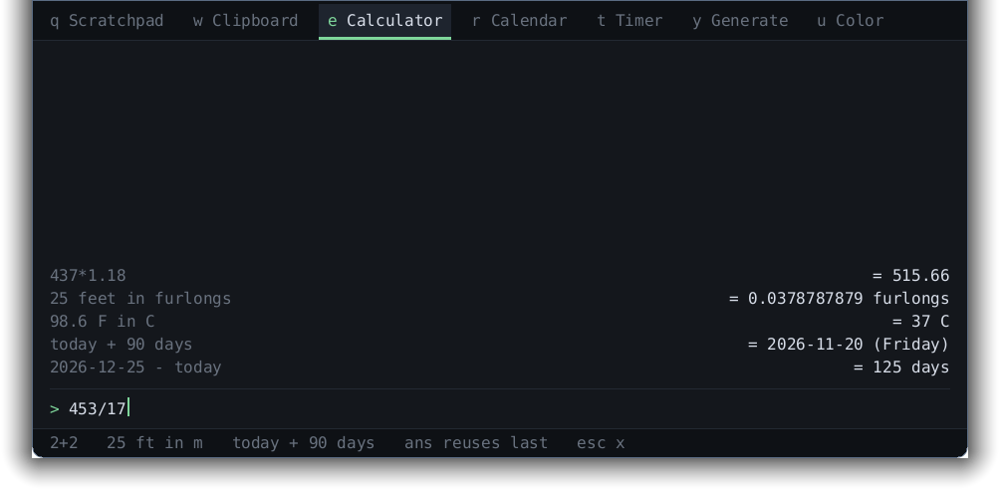
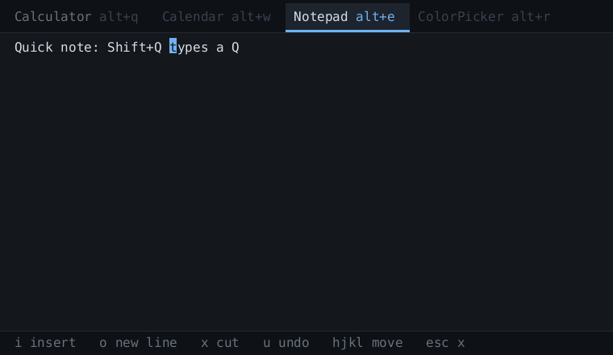

# Dropkick

Dropkick is a small collection of desktop tools that appears when you need it
and disappears when you don't.

It runs locally. It stores locally. It has no account system, no synchronisation
service, no telemetry, no advertisements, no AI integration, and no network
functionality.

Press a key. Do the thing. Get back to work.

## Status

Pre-alpha. The tab bar works, with two of four tools built: Calculator and
Notepad. Calendar and ColorPicker show as dimmed tabs holding their permanent
keys, so nothing renumbers when they arrive.





## How it behaves

There is no launcher screen and no root menu. Dropkick opens into whatever tool
you used last, with your values still in it, and the tools sit as tabs across the
top. So the common case costs nothing:

```
Super+D 437*1.18        you were already in the calculator
```

Switching tools is `Alt+Q`, `Alt+W`, `Alt+E`… — the top key row maps
left-to-right onto the tabs. `Alt`, not `Shift`, because `Shift+Q` is the letter
`Q` and would be swallowed by the tab bar the moment you started a note with it.

`Esc` always means "up one level": leave insert mode, leave the tool, dismiss.
Double-`Esc` dismisses from anywhere.

## The rules

* **Offline only.** Not "works offline". There is no network. Dropkick does not
  know how to talk to one. Dropkick cannot upload your data because Dropkick has
  no networking code.
* **Local, inspectable data.** Plain files in a directory you can open, back up
  and delete yourself.
* **Keyboard-complete.** Nothing *requires* the mouse. The mouse is not
  forbidden; it is simply never necessary.
* **No plugins.** Plugins are how a small offline utility acquires third-party
  code that can read your clipboard and open sockets. If a utility is worth
  having, it gets reviewed and compiled in.
* **Minimal retention of sensitive data.** Clipboard history is designed as
  though it contains passwords, because eventually it will.

The no-networking rule is meant to be *checkable by a stranger*, not merely
promised:

* `dropkick-core` is `#![forbid(unsafe_code)]` and has zero dependencies.
* `deny.toml` fails the build if any crate capable of opening a socket enters
  the dependency tree.
* Planned: a seccomp filter that denies `socket()` for `AF_INET`/`AF_INET6` at
  startup, so the process cannot open a network connection even if something
  slipped through. `AF_UNIX` stays permitted — the Wayland connection needs it.

## Threat model

Dropkick protects against: casual filesystem inspection, other local users,
accidentally syncing sensitive data elsewhere, Dropkick itself transmitting
anything, and unnecessary long-term retention.

Dropkick does **not** protect against: a machine already compromised under your
account, keyloggers, clipboard-monitoring malware, or an attacker running with
your privileges. Offline-only is not the same as secure, and Dropkick cannot
make a compromised computer safe.

That last point is not hypothetical, and it is worth stating plainly because
most people do not know it: **on this system any program you run can silently
read your clipboard, continuously, with no prompt and no permission.** During
development a ~200-line script with no window and no keyboard focus attached to
the clipboard and read it in about a second, using `ext_data_control_manager_v1`.
That is how every clipboard manager works. It is the environment Dropkick lives
in, not something Dropkick introduces.

The daemon's control socket is the one piece of attack surface Dropkick adds. It
lives in `$XDG_RUNTIME_DIR` at mode 0600 and understands four verbs that move a
window. There is no verb that reads clipboard history back out, and there must
never be one.

## Measured findings (Pop!_OS 24.04, COSMIC, cosmic-comp)

Everything below was measured on the target machine, not assumed.

**Global shortcuts.** `org.freedesktop.portal.GlobalShortcuts` does not exist on
this system — the session portal exports 20 interfaces and that is not one of
them. So the summon path is a compositor keybinding running `dropkickctl`, which
poke the resident daemon over a Unix socket. Full cost of that hop, including
`fork`, `exec`, dynamic linking, connect, ack and exit: **~1.1 ms median,
1.4 ms p95**. Bind the key straight to the binary; going through `sh -c` would
cost more than everything the program does.

**Summon latency**, 20 consecutive summons, milliseconds from daemon poke:

| metric | min | median | p95 | max |
|---|---|---|---|---|
| poke → configure | 0.29 | 0.50 | 0.74 | 1.32 |
| poke → buffer committed | 0.34 | 0.58 | 1.19 | 1.40 |
| poke → frame presented | 1.67 | 11.42 | 36.62 | 36.88 |
| **poke → keyboard focus** | **0.28** | **0.48** | **0.72** | **1.30** |

Keyboard focus is the number that matters. On Wayland a client cannot buffer
input it does not have focus for: before `wl_keyboard.enter`, keystrokes go to
whatever the user was typing into. "Accepts keystrokes before it finishes
painting" is therefore not a buffering problem — it reduces to acquiring focus
faster than the human's next keypress.

And it resolves well: **focus consistently arrives before the first frame is
even committed**, roughly 0.5 ms after the poke and ~11 ms before anything is on
screen. Total keypress-to-input-live is about **1.6 ms**, against a 50 ms
budget. Presentation lags focus, and that is fine — it is the desired behaviour,
reached without any special effort.

**Show/hide must destroy and recreate the layer surface.** The wlr-layer-shell
spec says an unmapped surface can be re-mapped by committing without a buffer
and waiting for a configure. On cosmic-comp that does not work: the first summon
succeeds, and every subsequent one commits and never receives a configure again.
Measured 4/4 stalls after the first. Destroying the `zwlr_layer_surface_v1` on
hide and building a fresh one on show works 20/20 at the latencies above, so
that is the strategy. Both paths remain in the code behind `--strategy` so the
comparison can be re-run on other compositors.

## Building

Requires Rust (via rustup) and, on Pop!_OS/Ubuntu:

```
sudo apt install build-essential cmake just libexpat1-dev libfontconfig1-dev \
    libfreetype6-dev libxkbcommon-dev pkgconf
```

Then:

```
cargo build --release
```

## Binding a key

Dropkick cannot register a global hotkey itself. This is not laziness: the
Wayland compositor owns global shortcuts, and on this system
`org.freedesktop.portal.GlobalShortcuts` does not exist at all. So the binding
lives in COSMIC and runs `dropkickctl`, which pokes the daemon over a Unix
socket in about a millisecond.

Create `~/.config/cosmic/com.system76.CosmicSettings.Shortcuts/v1/custom`:

```
{
    (modifiers: [Super], key: "d"): Spawn("/path/to/dropkickctl toggle"),
}
```

Bind to the binary directly. Going through `sh -c` would cost more than
everything `dropkickctl` does.

**Do not take `Super+Space`.** COSMIC's defaults bind it to
`System(InputSourceSwitch)`. A custom binding does override it — verified — but
a chord the desktop already defines is a bad neighbour, and it will confuse you
on a machine where you really do run two keyboard layouts. As of COSMIC on
Pop!\_OS 24.04 the free single-letter Super chords are `c d e n p v z`; the
window manager owns the rest, and `Super` alone is the launcher.

You do not need an autostart entry. If no daemon is running, `dropkickctl`
starts one and retries, so the first press of the session costs ~25ms and every
press after that is ~1ms.

## Keys

Tools, by permanent key:

| key | tool | |
|---|---|---|
| `Alt+Q` | Calculator | built |
| `Alt+W` | Calendar | not built |
| `Alt+E` | Notepad | built |
| `Alt+R` | ColorPicker | not built |

Calculator takes a plain expression: `+ - * / % ^`, parentheses, `sqrt abs ln
log sin cos tan round floor ceil`, the constants `pi` and `e`, and `ans` for the
previous result. `Enter` evaluates.

Notepad is vi-flavoured without being a vi clone: `i` `a` `A` `o` enter insert
mode, `Esc` leaves it, `hjkl` and `0` `$` move, `x` cuts, `u` undoes. Undo is
per *burst*, not per character, so one `u` takes back a whole typing run — which
is also what makes a keystroke that landed before you saw the panel recoverable.

## Trying the probe

```
./target/release/dropkickd --bench 20 --strategy recreate
```

Flashes a panel 20 times, grabs keyboard focus each time, prints the table
above. To exercise the real path instead, run the daemon and poke it:

```
./target/release/dropkickd
./target/release/dropkickctl toggle --time
```

The UI can also be rendered without a compositor, which is how it gets reviewed
without anyone having to describe a screenshot in prose:

```
./target/release/dropkickd --shot /tmp/dk
```

## Layout

```
crates/dropkick-core     utilities and state; knows nothing about any OS
crates/dropkick-linux    Wayland/COSMIC adapter, daemon, dropkickctl
```

A `dropkick-windows` crate joins them later. The core never learns what platform
it is on.
